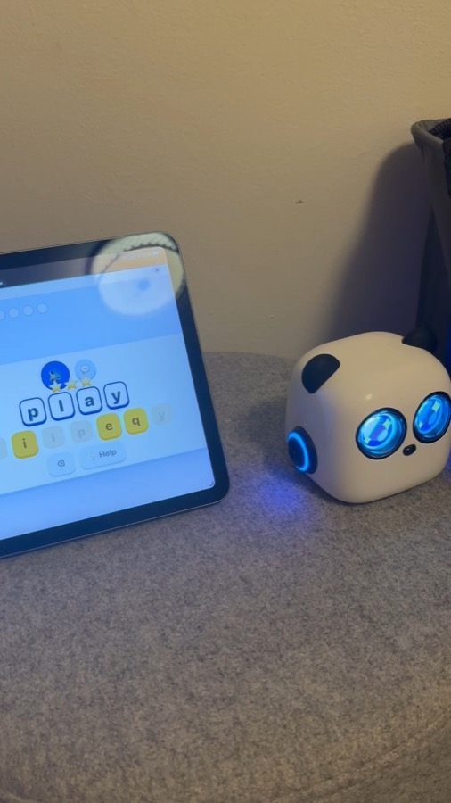
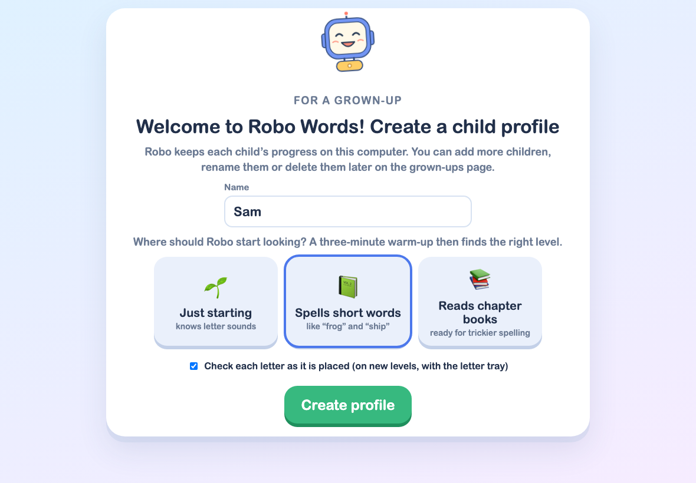
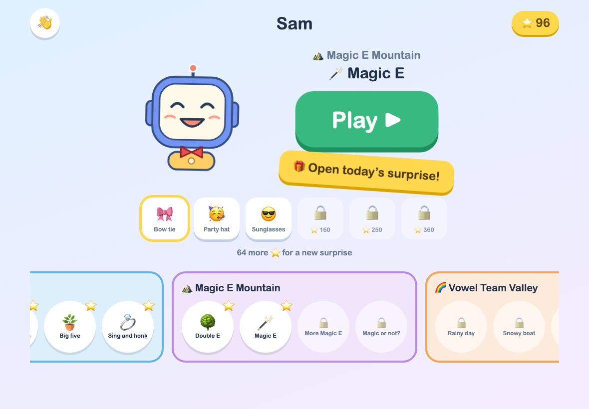
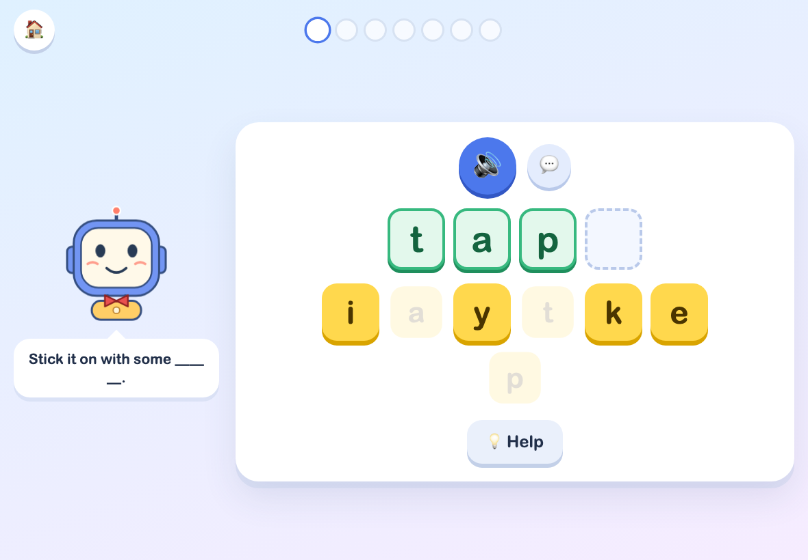
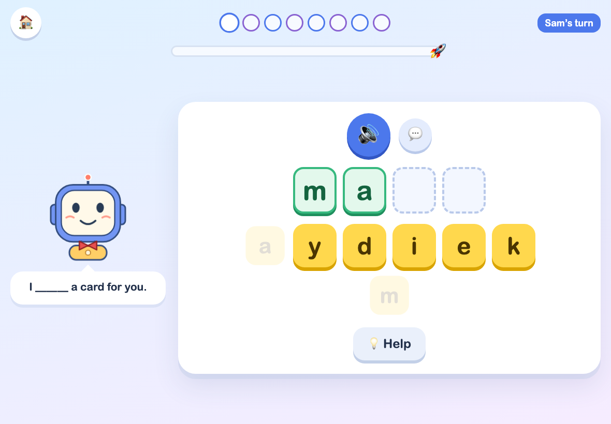
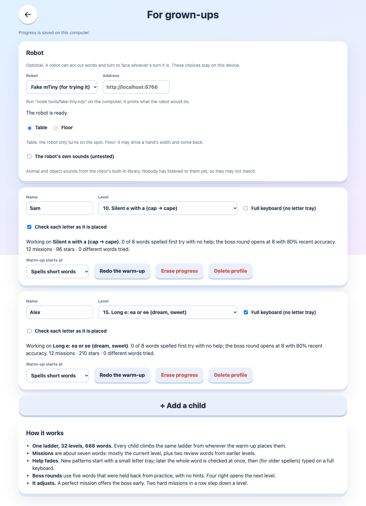

# Robo Words

A spelling game for children, played in a browser (made for an iPad or a laptop). One 32-level ladder takes a child from short sounds like "cat" up to tricky words like "because". A short warm-up finds the right starting level, then Robo gives short missions, boss rounds and daily surprises. Several children can have their own profile, and two can play together.

I built it because I could not find anything like it online for kids who have graduated from Reading.com: something that keeps teaching spelling patterns after the first reading program is done. Depending on interest, it may become an iPad game.

<a href="https://youtube.com/shorts/RzYreInii0E"></a>

**[Watch the 35-second demo on YouTube](https://youtube.com/shorts/RzYreInii0E)**: the game on an iPad, with the optional robot reacting.

This is a hobby project to learn robotics and make a fun game for kids. The code, this README and the rest of the repository were written by an AI coding agent (Claude) working with a parent.

| First run | Level map |
| --- | --- |
|  |  |

| Spelling a word | Playing together |
| --- | --- |
|  |  |



## Quick start

You need [Node.js](https://nodejs.org) 24 or newer.

```sh
npm ci
npm run build
npm start          # http://localhost:8000
```

Open http://localhost:8000. The first time, there are no children yet, so the game opens a "create a child profile" page. Enter a name, say roughly where the child is, and press **Create profile**. Robo then runs a three-minute warm-up to find the right level.

Everything the game needs is in this folder. Progress is saved in `data/robo2.sqlite3` (created on first run). To use another port or database: `node server.mjs --port 8001 --db /some/path.sqlite3`.

After changing code or words, run `npm run build` again. The running server picks up the new files without a restart.

No sound files are included. Without them the game speaks every word, sentence, lesson and Robo line with the browser's built-in voice, so it is fully playable as it is. See [Recorded voice](#recorded-voice-optional) for nicer audio.

## Ways to launch it

1. **This computer only.** `npm start`, then open http://localhost:8000.
2. **Other devices on the same Wi-Fi.** Find the computer's address (on a Mac: System Settings, Wi-Fi, Details, or `ipconfig getifaddr en0`) and open `http://<computer-ip>:8000` on the iPad. The server listens on all network interfaces. Anyone on that network can open the game, so use a network you trust.
3. **From an iPad anywhere, with Tailscale (optional).** Install [Tailscale](https://tailscale.com) on the computer and the iPad, then on the computer run `tailscale serve --bg 8000`. Tailscale prints an HTTPS address like `https://your-computer.example.ts.net/`; open it on the iPad while Tailscale is connected. Only your own devices can reach it. Other ways of reaching the computer work just as well; this is one that needs no router settings.

To keep the game running without a terminal on a Mac, copy `deploy/spell-server.plist.example` to `~/Library/LaunchAgents/`, replace the `/path/to/...` placeholders, and load it with `launchctl` (the steps are in the file). It restarts the server if it stops.

On an iPad, "Add to Home Screen" in Safari makes it open full-screen like an app. Safari only plays sound after a tap, so Robo starts speaking on the first touch.

## How the game works

- **Profiles.** Each child has a profile with a name, a level, stars and their word history. Make, rename and delete them on the grown-ups page. Progress is stored on the computer running the server, so every device sees the same thing.
- **Warm-up.** A grown-up picks a starting point when creating the profile. Robo then asks for two words per level, jumping up six levels after a pass and closing in after a miss.
- **Missions.** About seven words: mostly the current level plus two review words from earlier levels.
- **Fading help.** A new level starts with a small letter tray. Each letter can be checked as it is placed (a per-child option, on by default). After four clean words the whole word is checked at once. Children placed at "ai / ay" or above move on to a full keyboard. Both can be changed on the grown-ups page.
- **Boss round.** Every fourth word in a level is held back. After eight clean practice words (or one perfect mission) the boss asks five of them with no hints and no picture; four right opens the next level.
- **Stepping down.** Two missions in a row under 40% clean move down one level.
- **Together mode.** On the first screen, "Play together" lets you pick any two children. They take turns, four words each at their own level. Each child's words count toward their own progress; the stars are pooled, and 16 of the possible 24 launch the rocket.
- **Word reactions.** Robo acts out some words when they are spelled (hops for "hop", flies for "plane") and showers the word's picture. The list is in `src/content/reactions.ts`.
- **Daily surprise.** After the first mission of the day a present opens on the home screen: a joke, plus a new Robo colour until all seven are collected.
- **Grown-ups page.** Press and hold the button on the first screen for a second (or open `/#grownups`). Add, rename or delete children, set a level by hand, switch the keyboard or per-letter checking on or off, redo the warm-up, see recent tricky words, and choose a robot.

## The grown-ups page and profiles

Open it with the press-and-hold button on the first screen. Besides what is listed above, **+ Add a child** makes another profile and **Delete profile** removes one for good (after a confirmation). **Erase progress** keeps the child and starts them over.

Profiles can also be managed from a terminal while the server runs:

```sh
npm run profiles -- list
npm run profiles -- create "Sam" --start 5      # --start 0 (just starting), 5 (short words) or 12 (chapter books)
npm run profiles -- rename sam "Samantha"
npm run profiles -- delete sam
```

## Robot (optional)

The game can drive a small robot that acts out words, looks puzzled at a wrong answer, turns toward whoever's turn it is in together mode, and dances at the end of a mission, boss round or rocket launch. It is a plug-in: the game only talks to the small interface in `src/robots/types.ts`, and the default is no robot.

On the grown-ups page, **Robot** chooses the type and its address. These choices are saved per device, not per child.

- **Makeblock mTiny.** The one supported robot today. You have to buy the robot from [Makeblock](https://www.makeblock.com); nothing of theirs is included here, and this project is not affiliated with them. It talks to the HTTP API of the companion project [robot-mtiny-control](https://github.com/mb-dev/robot-mtiny-control). Run that server, then enter its address. The address is called from the browser, so the robot server must be told to allow the game's address, and if the game is served over HTTPS the robot address must be HTTPS too. On one computer: start the robot server with `--allow-origin http://localhost:8000` and enter `http://localhost:8765`. Over Tailscale: give the robot its own tailnet name, start it with `--allow-host` and `--allow-origin-suffix` as its README describes, and enter that name (for example `https://tiny.example.ts.net`).
- **Fake mTiny.** Try it without hardware: run `node tools/fake-tiny.mjs` (port 8766) and choose "Fake mTiny". It prints every step the robot would take.
- **Table or Floor** (mTiny). Table: the robot only turns on the spot. Floor: it may drive up to 100 mm out and back. Every routine ends where it started, facing the same way.
- **If the robot is missing,** requests fail quietly and are not retried for 30 seconds; the game never waits for it.

**Planned:** an open-source robot built on a micro:bit, so the robot side needs no bought toy. I am working my way up the chain.

To add another robot, implement the `Robot` interface in a new file under `src/robots/` and add one entry to `ROBOT_TYPES` in `src/robots/index.ts`.

## Recorded voice (optional)

Nothing in `public/audio/` ships with this repository, and it is ignored by git. If a recording is missing, the game uses the browser's built-in speech for that clip, which covers:

- words, example sentences and each level's lesson text;
- all of Robo's lines and the daily jokes;
- Robo's "it is your turn!" line in together mode. It has no name in it; the child's name appears on screen.

The one exception is letter sounds (the sound a letter makes, played when a letter is tapped on the first few levels). The device voice would say the letter's name ("bee") instead of its sound, which would teach the wrong thing, so without the files those taps are silent.

**Where the sounds came from.** In the author's own copy of the game, none of the audio was recorded by a person:

| Sounds | Source | In this repository? |
| --- | --- | --- |
| Words, sentences, lessons, Robo's lines, jokes | Generated on a Mac with the open [Kokoro](https://github.com/hexgrad/kokoro) text-to-speech model (`mlx-community/Kokoro-82M-bf16`, voice `af_heart`) through [mlx-audio](https://github.com/Blaizzy/mlx-audio), by `tools/make_audio.py` | No, but `npm run audio` regenerates all of it |
| Letter sounds (a to z) | [Phonicademy](https://phonicademy.com/phonemes) phoneme recordings, under their free license | No; their license does not allow passing the files on, so you download them yourself |
| Chimes and effects | Synthesised in the browser by `src/audio.ts` | Yes, it is code |

**Set up the voice generator (Apple silicon Mac, once).** The tested environment was Python 3.12 with `mlx-audio` 0.6.5, `misaki` 0.9.4, `phonemizer-fork`, `espeakng-loader`, `num2words` and `spacy`:

```sh
python3.12 -m venv ~/.cache/kokoro-tts/.venv
~/.cache/kokoro-tts/.venv/bin/pip install mlx-audio "misaki[en]" phonemizer-fork espeakng-loader num2words spacy
```

Keep it at that short path: Kokoro's pronunciation library fails with a "phontab" error when the install path is long. The first run downloads the model from Hugging Face. `afconvert` (built into macOS) makes the small AAC files.

**Generate Robo's voice yourself.** `npm run audio` lists every clip the game needs (`tools/manifest.ts` writes `tools/manifest.json`) and records the missing ones with [Kokoro](https://github.com/hexgrad/kokoro) (voice `af_heart`) through [mlx-audio](https://github.com/Blaizzy/mlx-audio) into `public/audio/` (`w/` words, `s/` sentences, `l/` lessons, `r/` Robo lines, `j/` jokes). It uses a Python environment at `~/.cache/kokoro-tts` (it must be a short path, because Kokoro's pronunciation library fails on long ones) and `afconvert` for the AAC files. It only records clips that are missing; to re-record one, delete its `.m4a` first. Then run `npm run build`; the server serves `public/audio/` from `dist/audio/`.

**Letter sounds.** The original game used the free letter-sound recordings from Phonicademy. They may not be redistributed, so they are not included here. Get them from [Phonicademy's audio license page](https://phonicademy.com/audio-license), read their terms, and save one file per letter as `public/audio/letters/a.mp3`, `b.mp3`, ... `z.mp3`. Or record or find your own. The grown-ups page shows a Phonicademy credit only when those files are installed.

## Adding or changing words

Word lists are `src/content/words-*.txt`: a `## level-id` heading per level, then one `word | emoji | sentence` line per word. The sentence must contain the word. The level order, lesson text and Robo's lines are in `src/content/defs.ts`.

```sh
npm test          # checks every level has enough words and every sentence contains its word
npm run build
```

If you use recorded voice, run `npm run audio` before `npm run build` to record the new clips.

## Where things live

| Path | What |
| --- | --- |
| `src/content/defs.ts` | The ladder: level order, lesson text, Robo's lines |
| `src/content/words-*.txt` | Word lists, one section per level |
| `src/engine.ts` | Rules: placement, mission planning, scoring, moving up and down |
| `src/App.tsx`, `src/Play.tsx` | Screens: profiles, home, grown-ups page, playing |
| `src/robots/` | The robot plug-in: interface, registry, mTiny, no-robot default |
| `src/audio.ts` | Recorded clips with device-voice fallback, sound effects |
| `src/store.ts` | Saving profiles to the server and the browser |
| `server.mjs` | Serves `dist/`, stores profiles and the event log in SQLite |
| `tools/` | Audio clip list and recorder, profile CLI, event log reader, fake robot |
| `deploy/` | launchd service template |

## Development

```sh
npm run lint        # Biome
npm run typecheck   # tsc
npm test            # node's test runner via tsx
npm run build       # typecheck, then Vite
npx vite            # dev server on 5174; proxies /api to a game server on port 8000
```

Tests never need the real data folder. The server tests start their own server on a free port with a temporary database.

## Reloading

Each device remembers who was playing and, at the start of every word, the game in progress (warm-up, mission, boss or together). After a reload it shows "Welcome back!" and carries on at the same word once tapped. Saved places older than three hours are ignored. Pending saves are sent when the page is closed or reloaded.

## Event log

The game records what happens during play so problems can be found later: which words take longest, where hints are used, whether the robot answers, why the press-and-hold button failed on a device. Events are batched and sent to the computer running the server (`POST /api/events`) into the `events` table of the same SQLite file; nothing leaves that computer. Sending is fire-and-forget; if the server is unreachable the events wait (up to 1000, also kept in the browser) and go out later.

- **What is recorded.** Page loads (device, build, screen size), screens, who was picked (by profile id), every press of the grown-ups button, each session and word (taps, removes, checks with the attempt, hints, reveals, listens, time to first tap, total time), lessons, resumes, gifts and closet changes, every robot status check and command, audio clips that failed (and the speech fallback), failed profile saves, and JavaScript errors. Letters typed are included.
- **Read it.** `npm run events` opens the database read-only, so it is safe while the game runs.
  - `npm run events -- --tail 50`, `--who <profile-id>`, `--type hold`, `--since 2h` (or `30m`, `1d`), `--device ipad-3f9a2c`, `--db path`: recent events, one per line.
  - `npm run events -- --summary [--who id] [--since 7d]`: per child, sessions, median and slowest words, hints per word, most-missed words, robot outcome counts, error and audio-problem counts.
  - Over HTTP: `/api/events?who=&type=&device=&since=<ms>&limit=` (newest first, up to 5000).
- **Retention.** Events older than 90 days are deleted when the server starts and once a day after that.

## Using an AI coding agent

This repository has `CLAUDE.md` (also linked as `AGENTS.md`) and a skill in `.claude/skills/robo-words/` that tell a coding agent how the project works. You can paste prompts like these:

- **Set up and run:** "Read CLAUDE.md. Install dependencies, build the game and start it on port 8000. Tell me the address to open on this computer and on my iPad on the same Wi-Fi."
- **Create profiles:** "Start the game server, then create child profiles for Sam and Alex using the profile CLI in tools/. Sam is just starting; Alex spells short words. List them to check."
- **Add words:** "Add these 10 words to the 'magic-a' level in src/content/words-b.txt, each with an emoji and a sentence that contains the word. Run the tests and rebuild."
- **Record the voice:** "Set up Kokoro with mlx-audio as described in the README, run npm run audio, and rebuild. Don't commit anything from public/audio."
- **Connect a robot:** "I run robot-mtiny-control at https://tiny.example.ts.net. Tell me how to choose Makeblock mTiny on the grown-ups page and check that the robot answers. Test with the fake robot first."
- **Launch on login (Mac):** "Turn deploy/spell-server.plist.example into a launchd service for this folder and this node, load it, and check port 8000 answers."

Agents should never read or copy `data/`, which holds real children's progress.

## License

MIT. See `LICENSE`.
